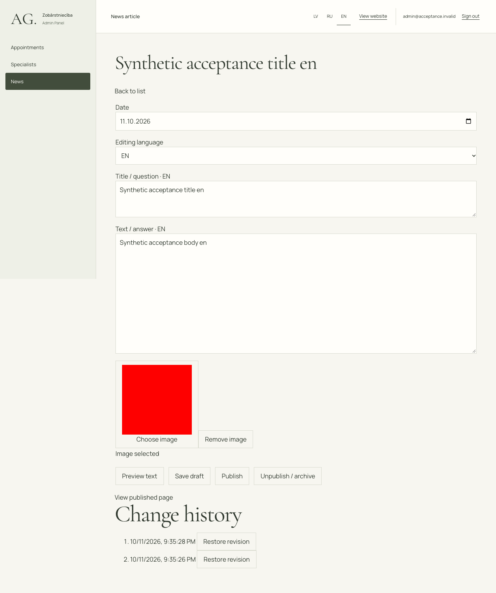

# News administration simplification and validation

> Status clarification — 2026-10-13: The later [reversible archive implementation](NEWS_DELETION_FIX.md), [publication validation fix](NEWS_PUBLICATION_VALIDATION_FIX.md), and [admin session fix](ADMIN_AUTO_REFRESH_FIX.md) supersede the initial removal and editor behavior described below.

Branch: `feature/final-development`. Review baseline: `e402516`. Local implementation only; no commit, push, deployment, production mutation or migration.

## Investigation and root causes

- The active News route rendered `AdminCmsView`, its static imported-document navigator and a separate `AdminCreatedList`. Imported and newly created articles had different editors, list presentations and publication flows. The list response exposed titles only for the structured created payload; imported payloads store titles under LV/RU/EN. One unified list now projects both representations without converting their identities.
- The created editor's primary action saved a draft. Publication was a second request/action, disabled while unsaved. There was no coordinated create-and-publish backend operation. The new operation wraps the existing validated creation/revision/publication functions in one PostgreSQL transaction.
- The created editor did not explicitly revalidate public content after publishing/unpublishing. Existing navigation/focus refreshes could mask this. Revalidation now follows successful publication/removal/restoration and waits out an already-running older fetch before requesting fresh content.
- Created articles were appended after all imported articles on the public listing regardless of publication date. The same public design now sorts the combined list by date, newest first.
- No removal action existed on the list. Backend unpublication already existed and preserved history. The new list exposes that safe operation as **Remove from website**, with confirmation and an unpublished state; the retained editor can republish or restore an earlier publication.
- Imported articles used a fixed paragraph-array shape and generic CMS fields. A single text editor needs variable paragraph counts. Validation now permits bounded, nonempty plain-text paragraph arrays while preserving the original object shape, source identity, locked slugs and other field/media checks. Invalid JSON roots are explicitly rejected.
- The server SEO renderer discarded `withdrawn_news`; it could keep retired imported articles in the sitemap and return baseline metadata/200. It now consumes the withdrawal set, excludes those URLs, and returns 404/noindex for retired articles. Existing legacy redirects remain unchanged and terminate at the retained article path (404 while withdrawn); no homepage redirects are introduced.

### What could and could not be reproduced

The old two-step publication workflow, split list architecture and missing list removal control are confirmed directly in the prior code. The existing public pipeline already supported `created.news.*`; no separate production article registry insertion or frontend rebuild is needed for publishing new articles.

The particular reported historical disappearance/generic CMS error was **not conclusively reproduced against the user's running authenticated instance**. It would be inaccurate to assert corrupt production data or a missing migration. Read-only checks of the existing local backend returned `/api/health` 200 and unauthenticated CMS access 401. Its process predates this implementation and must be restarted with the new source before the new atomic endpoint is available. No authenticated production record query or mutation was used to diagnose it. All new functional verification uses disposable PostgreSQL and synthetic records.

## Editor and publication behavior

- News opens one card list containing imported and created articles, title/image/date/status, Add News, Edit and Remove from website.
- Add/Edit opens a separate clean editor with one content-language selector, title, main image, publication date and text. No exposed keys, slugs, revision numbers or draft-save requirement.
- All three languages remain required. No translations or clinic claims are generated. New safe slugs derive from the Latvian title; existing identities/slugs are retained.
- One explicit Publish submits to `POST /api/admin/cms/documents/:key/save-publish` with the existing expected version and payload. New articles use a stable UUID key for retries.
- The transaction rechecks the actor's database role, serializes creation, locks the document, checks source hash/version, validates content/media, and records the existing draft/publication audit events. Failure rolls everything back. Identical immediate retries return the same publication; stale retries cannot resurrect an unpublished article. Conflicting edits remain conflicts.
- Successful server confirmation returns to a freshly loaded list and refreshes public delivery. Errors preserve unsaved input; localized messages distinguish incomplete fields, invalid content, conflicts and unavailability.
- Main-image selection uses the existing authorized inline media picker/upload pipeline. Disabled uploads remain disabled and visibly unavailable. The tests never enable production uploads.
- Revision restoration is retained under a collapsed “Previous versions” disclosure. Removal never deletes documents, revisions, historical media references or audit events.

## API / database changes

New authenticated/admin-only atomic News publication endpoint above. CMS list metadata adds `image` and `date` and localized imported titles. No tables, migrations, grants, RLS policies, production settings or media storage policies change. Publication is restricted to known imported articles and valid `created.news.*` definitions; Hero/page/service documents cannot use this endpoint.

## Before / after evidence

Before (existing accepted synthetic screenshot from the baseline, not a new production capture):

After, desktop unified list:

After, mobile editor:

Additional LV/RU/EN list/editor captures at 390 and 1440px are under `docs/screenshots/news-simplification/`. These local QA captures remain ignored by Git, consistent with the repository policy; no forced staging was performed. Browser checks cover 320, 375, 390, 430, 768, 1024, 1440 and 1920px.

## Tests and evidence

- Production frontend build passed (existing large-chunk warning remains).
- All 111 frontend unit/HTTP tests passed, including withdrawn-news 404 and dynamic sitemap exclusion/inclusion.
- Go tests and disposable PostgreSQL 17.11 integration passed: migrations, Auth, Booking, CMS, Media, admin operations. Additional News cases cover atomic create/edit publication, exact retries, failed-media rollback, source/identity protection, malformed payloads, variable imported paragraphs, archive/restore, and role revocation. `go vet ./...` passed.
- Real local official Supabase Auth and Storage + Go + PostgreSQL + Vue acceptance passed: direct publication, immediate admin/public listings, detail images, LV/RU/EN, refresh persistence, edit/republish, real image upload/replacement, archive/restore, duplicate retries, concurrent identical creations (one revision), revoked-role rejection, JWT/ordinary-user denial, private Storage access, historical media protection and safe unreferenced deletion. Evidence: `NEWS_ADMIN_REAL_EVIDENCE.json`. All disposable services and private credentials were removed.
- News browser matrix: 24 locale/viewport cases passed, including failed-request input preservation. Imported-news edit/archive/public filtering/restore: six cases passed.
- All 15 Hero locks passed; Welcome Intro and public visual components remain unchanged. Only public list ordering and delivery/SEO logic changed.

The final regression matrix and exact file inventory are recorded below. Mocked browser contracts are distinct from the real isolated integration run; neither claims hosted production acceptance.

## Remaining limitations / activation

1. Restart the local backend from this source before using the new News editor. An older process cannot serve the new endpoint; no database migration is required.
2. Production remains unchanged. Deployment, production uploads and hosted API configuration require separate approval. Dynamic content/SEO requires the existing `VITE_API_URL` and server-side `CMS_PUBLIC_API_URL` configurations to point to the intended reachable backend.
3. The historical error's exact production request/response was not captured; this report does not attribute it to unverified production schema or content corruption.
4. If the CMS is unreachable, the existing approved public fallback/last-known-content policy remains. A disconnected deployment cannot guarantee immediate withdrawal visibility; verify hosted API connectivity before activation.
5. Removal is reversible unpublication, not permanent deletion. Unpublished articles stay in the administrator list for recovery. Three complete translations and a valid image remain required for direct publication.
6. No Resend/email delivery, production uploads, Booking activation, Hero/Welcome changes, or live clinic content edits.

## Exact changed files

- `backend/internal/cms/content.go`
- `backend/internal/cms/content_test.go`
- `backend/internal/cms/http.go`
- `backend/internal/cms/integration_test.go`
- `backend/internal/cms/news.go`
- `backend/internal/cms/news_test.go`
- `backend/internal/cms/store.go`
- `backend/scripts/acceptance-local.py`
- `docs/NEWS_ADMIN_REAL_EVIDENCE.json`
- `docs/NEWS_ADMIN_SIMPLIFICATION_FIX.md`
- `frontend/api/render.ts`
- `frontend/src/i18n/newsAdmin.ts`
- `frontend/src/main.ts`
- `frontend/src/router/admin.ts`
- `frontend/src/services/admin/access.ts`
- `frontend/src/services/cms/admin.ts`
- `frontend/src/services/cms/content.ts`
- `frontend/src/views/NewsView.vue`
- `frontend/src/views/admin/AdminNewsView.vue`
- `frontend/tests/acceptance-workflows.cjs`
- `frontend/tests/created-content-browser.cjs`
- `frontend/tests/helpers/news-real-workflow.cjs`
- `frontend/tests/news-admin-browser.cjs`
- `frontend/tests/news-archive-browser.cjs`
- `frontend/tests/news-real-browser.cjs`
- `frontend/tests/seo-server.test.mjs`

Plus 12 ignored local QA PNGs under `docs/screenshots/news-simplification/`; no screenshot or private diagnostic was staged.

## Final regression matrix

| Suite | Result |
|---|---|
| News editor/list/error retention/public persistence | PASS, 24 locale/viewport workflows |
| Imported News edit/archive/restore | PASS, 6 locale/viewport workflows |
| Booking browser | PASS, 172 layout checks + 31 flows |
| Auth browser | PASS on rerun, 96 layouts + registration/login/persistence/logout/recovery/confirmation |
| Appointments | PASS, 24 scenarios |
| Specialist editor | PASS, 24 scenarios |
| Specialist linking | PASS on rerun, 6 scenarios |
| Specialist absence | PASS, 6 scenarios |
| Specialist media | PASS, 3 scenarios |
| Simple admin workflows | PASS, 24 scenarios |
| Admin authorization | PASS, 12 guest/user/unavailable-identity cases; zero privileged requests |
| Public routes | PASS, 480 checks |
| SEO browser | PASS, 120 checks |
| Contact | PASS, 24 layouts + 24 validation/no-delivery flows |
| Frontend unit/HTTP | PASS, 111 tests |
| Frontend build | PASS; existing chunk-size advisory only |
| Go / disposable PostgreSQL | PASS all packages, integration enabled |
| Go vet / whitespace / Hero locks | PASS / PASS / 15 of 15 |

Initial broad-run Auth account-menu timing and specialist-link dialog teardown failures passed on rerun without changes to Auth, Specialists or their tests. They remain test-timing observations, not silently omitted failures. Historical generic CMS browser entry points for the superseded editor are not claimed as current UI acceptance; the created-content entry point now executes the unified News workflow, and imported News has its dedicated updated regression.

Final review additionally preserves raw textarea input while typing blank lines in imported articles; paragraph validation is performed against the normalized payload without collapsing the user's typing. The imported browser regression includes actual Enter/Enter/typing, not only programmatic filling.

Final confirmation: a fresh full disposable PostgreSQL/Go run passed all packages after one earlier unchanged direct-SQL Booking race produced SQLSTATE 40P01 (the test expects 23P01). No Booking code or test was weakened; API collision-protection regressions and the rerun passed. Treat the raw-race assertion as a remaining nondeterministic test limitation. Final imported typing regression passed all six cases. Build, 111 unit tests, whitespace and 15 Hero locks passed. Exactly 26 tracked-modified/new non-ignored files are listed above. HEAD remains `e402516`; nothing was staged, committed or pushed.
